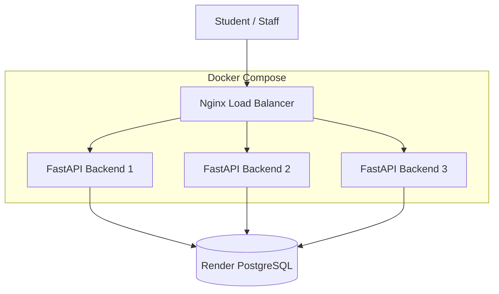

# CampusFlow – Campus Service Queue Management System

A cloud-connected campus service queue management system built using **Python, FastAPI, PostgreSQL, Docker, and Nginx**.

CampusFlow helps students access university services, submit service requests, and track their queue status. It also provides backend operations for managing service requests and queue priorities.

## Overview

CampusFlow is designed to simplify the management of campus services such as:

- Hostel Office
- Library
- Lab Support
- Student Administration

The DA3 implementation focuses on backend scalability, availability, cloud database integration, performance testing, and container security.

## Architecture



### Architecture components

| Component | Technology | Purpose |
|---|---|---|
| Backend | Python, FastAPI | REST API and application logic |
| Database | PostgreSQL | Store services and queue requests |
| Cloud hosting | Render PostgreSQL | Host the application database |
| Containerisation | Docker | Package backend instances |
| Orchestration | Docker Compose | Manage multiple containers |
| Load balancer | Nginx | Distribute incoming requests |
| Vulnerability scanning | Trivy | Scan Docker images |

## Features

- View available campus services.
- Create and manage service requests.
- Track queue status and position.
- Update request status and priority.
- Cancel and delete requests.
- Manage queue progression.
- Run multiple FastAPI backend instances.
- Distribute requests through Nginx.
- Connect to a cloud-hosted PostgreSQL database.

## Project Structure

```text
CampusFlow/
│
├── backend/
│   ├── main.py
│   └── Dockerfile
│
├── frontend/
│
├── nginx/
│   └── default.conf
│
├── docker-compose.yml
├── load_test.py
├── requirements.txt
├── render.yaml
├── .gitignore
└── README.md
```

## Getting Started

### Prerequisites

Install the following:

- Python 3.12+
- Docker Desktop
- Docker Compose
- Git

### 1. Clone the repository

```bash
git clone <YOUR_GITHUB_REPOSITORY_URL>
cd CampusFlow
```

### 2. Configure environment variables

Create a `.env` file in the project root.

Configure the database connection using the following variables:

```env
DB_HOST=your_database_host
DB_PORT=5432
DB_NAME=your_database_name
DB_USER=your_database_user
DB_PASSWORD=your_database_password
```

Use your own PostgreSQL connection details. Do not commit `.env` or expose database credentials publicly.

### 3. Install dependencies (local development)

Create and activate a virtual environment:

```powershell
python -m venv venv
.\venv\Scripts\activate
```

Install dependencies:

```powershell
pip install -r requirements.txt
```

Run the backend:

```powershell
uvicorn main:app --reload --app-dir backend
```

API documentation is available at:

`http://localhost:8000/docs`

### 4. Run using Docker Compose

From the project root:

```powershell
docker compose up -d --build
```

Check running containers:

```powershell
docker compose ps
```

The Docker Compose setup starts:

- FastAPI Backend 1
- FastAPI Backend 2
- FastAPI Backend 3
- Nginx Load Balancer

Access the application API through:

`http://localhost:8080`

Interactive API documentation:

`http://localhost:8080/docs`

Stop the containers:

```powershell
docker compose down
```

## API Endpoints

The backend exposes REST APIs for service and queue management.

| Method | Endpoint | Description |
|---|---|---|
| GET | `/` | API information |
| GET | `/health` | Health check |
| GET | `/db-test` | Database connectivity test |
| GET | `/services` | Retrieve available services |
| GET | `/queue/{service_id}` | View service queue |
| GET | `/queue/{service_id}/next` | View or retrieve next queue position, as implemented |
| POST | `/requests` | Create a service request |
| GET | `/requests/{id}` | Retrieve a request |
| PATCH | `/requests/{id}` | Update a request |
| PATCH | `/requests/{id}/priority` | Update request priority |
| PATCH | `/requests/{id}/cancel` | Cancel a request |
| DELETE | `/requests/{id}` | Delete a request |
| POST | `/queue/{request_id}/complete` | Complete a queue request |

For request parameters and response schemas, refer to the interactive Swagger documentation at `/docs`.

## Scalability and Load Testing

A custom Python load-testing script was developed to evaluate backend performance.

**Test configuration:**
- Total requests: 1,000
- Concurrency: 20
- Test endpoint: `/services`

### Performance comparison

| Configuration | Requests/sec | Average latency |
|---|---:|---:|
| Single backend – Local DB | 17.59 | 1080.05 ms |
| Three backends – Local DB | 64.84 | 300.70 ms |
| Three backends – Render DB | 6.03 | 3294.32 ms |

These are observed results from individual test runs.

### Run the load test

```powershell
python load_test.py --url http://localhost:8080/services --requests 1000 --concurrency 20
```

### Failure testing

Backend failure handling was tested by stopping one backend instance while sending requests through Nginx.

```powershell
docker compose stop backend2
```

After testing, restore the instance:

```powershell
docker compose start backend2
```

**Observed result:** 1,000 successful requests and zero failed requests during the recorded partial-backend-failure test.

## Security and Container Hardening

Trivy was used to scan the backend Docker image.

| Severity | Before hardening | After hardening |
|---|---:|---:|
| HIGH | 44 | 44 |
| CRITICAL | 0 | 0 |

The following hardening measures were implemented:

- Updated operating system packages during image build.
- Removed package-manager cache files.
- Created a dedicated non-root user named `appuser`.
- Changed application directory ownership.
- Configured the container to run using `USER appuser`.

Non-root execution was verified using:

```powershell
docker compose exec backend1 id
```

The vulnerability count remained unchanged after hardening; further remediation is required.

## Future Improvements

The following features are planned but are not yet implemented:

- Argon2id or bcrypt password hashing.
- TOTP-based multi-factor authentication.
- JWT-based authentication and role-based access control.
- Migration to a smaller Docker base image.
- Frontend implementation.
- Edge/fog computing extension for campus-level caching.
- HTTPS termination and API rate limiting.

## Technologies Used

**Backend:** Python, FastAPI, Uvicorn

**Database:** PostgreSQL, Render

**Infrastructure:** Docker, Docker Compose, Nginx

**Testing and Security:** Custom Python load-testing script, Trivy

## Author

**Shubham Ghosh**

VIT Chennai – Computer Science and Engineering

## Project Status

DA3 implementation demonstrating containerised backend scalability, cloud database integration, load balancing, failure testing, and Docker security hardening.

